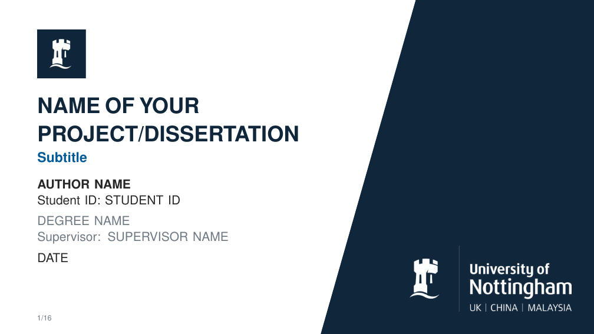
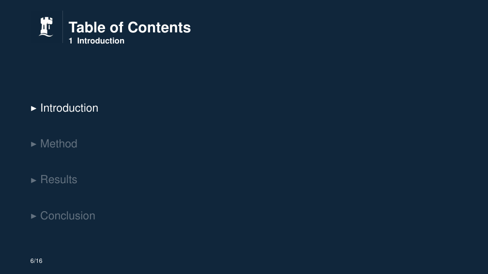
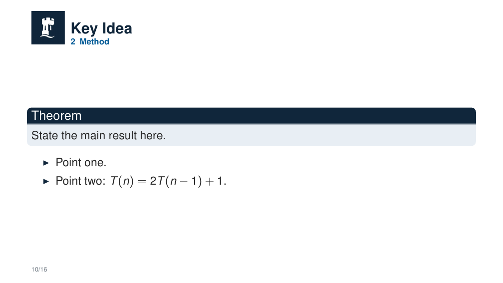
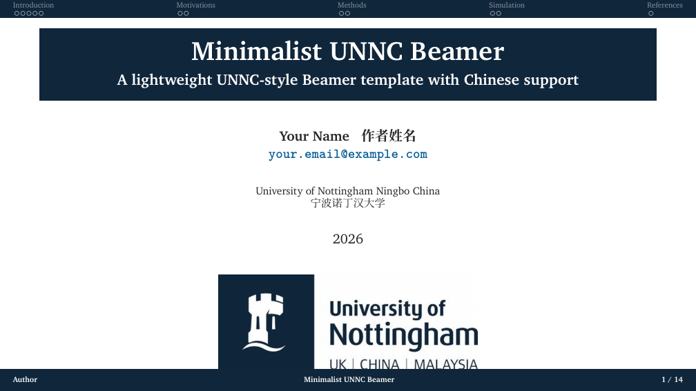
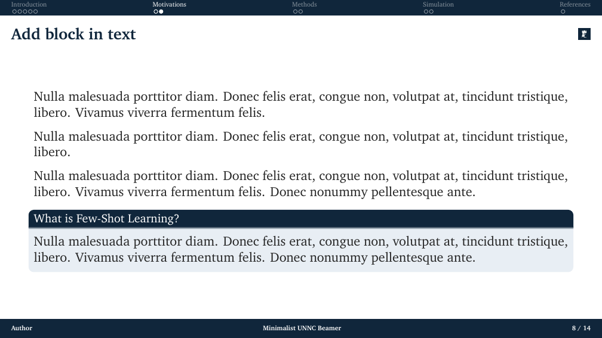
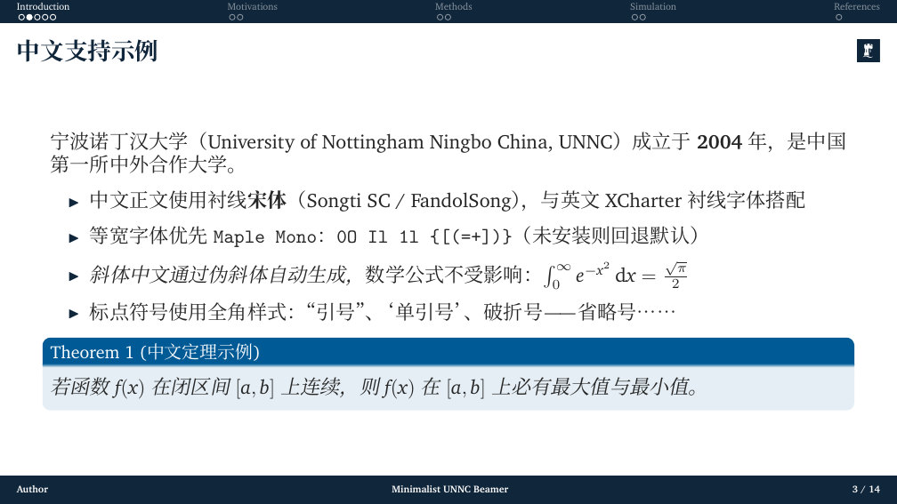

# UNNC Beamer 模板

两套宁波诺丁汉大学（UNNC）Beamer，分开放在两个目录里。进入所选目录再编译。

Two UNNC Beamer templates. Compile inside the directory you choose.

| | [thesis-style](thesis-style/) | [minimalist](minimalist/) |
| --- | --- | --- |
| 编译器 | **pdfLaTeX** | **XeLaTeX** |
| 语言 | 英文（有 Lato 时用 Lato，否则 Helvetica） | 中英文混排 |
| 结构 | 论文式多文件：`preface/`、`body/`、`appendices/` | 单文件 `main.tex`，正文页带顶部小节导航 |
| 全文 | [thesis-style/main.pdf](thesis-style/main.pdf)（16 页） | [minimalist/main.pdf](minimalist/main.pdf)（14 页） |
| 说明 | [thesis-style/README.md](thesis-style/README.md) | [minimalist/README.md](minimalist/README.md) |

Overleaf 使用 **New Project → Upload Project**，只上传所选的那一个文件夹。

## Thesis-style（pdfLaTeX）

论文式幻灯片，16:9，版式改编自 UNNC Overleaf 论文模板。源文件在 [thesis-style/](thesis-style/)。

封面：



节页（进入 Introduction 时的目录）：



正文（Method 中的 Key Idea）：



在 `thesis-style/` 中执行：

```bash
cd thesis-style
pdflatex main
bibtex main
pdflatex main
pdflatex main
```

在 [thesis-style/main.tex](thesis-style/main.tex) 填写 `\title`、`\subtitle`、`\author`、`\submitdate`、`\degree`、`\studentid`、`\supervisor`。前言在 `preface/`，章节在 `body/`，附录在 `appendices/`，文献在 `bibliography/bibliography.bib`（样式 `unsrt`）。

## Minimalist（XeLaTeX）

极简 UNNC Beamer，支持中文，正文页顶部是分节导航。源文件在 [minimalist/](minimalist/)。

封面（作者占位为 Your Name / 作者姓名）：



正文页（顶部小节导航，当前节高亮）：



中文示例：



在 `minimalist/` 中执行：

```bash
cd minimalist
latexmk -xelatex main.tex
```

Overleaf 将 Compiler 设为 **XeLaTeX**，然后重新编译两次（第二遍刷新顶部导航、目录和文献引用）。手动编译时在中间运行一次 BibTeX：

```bash
xelatex main
bibtex main
xelatex main
xelatex main
```

作者占位是 `Your Name / 作者姓名`，页脚短作者是 `Author`。标题、作者和 `\section` 都在 [minimalist/main.tex](minimalist/main.tex)，文献在 [minimalist/ref.bib](minimalist/ref.bib)。

幻灯片结构改编自 [Minimalist PKU Beamer 2026](https://github.com/rexera/minimalist-pku-beamer-2026)（MIT）。标识、配色与 `beamerthemeUNNC.sty` 为 UNNC。
