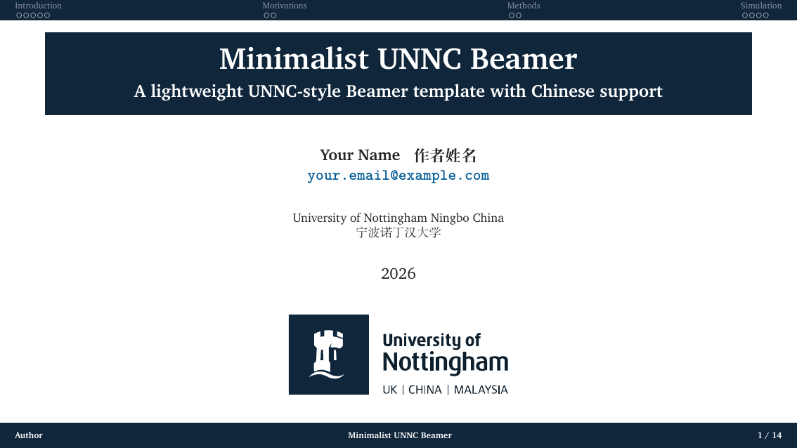
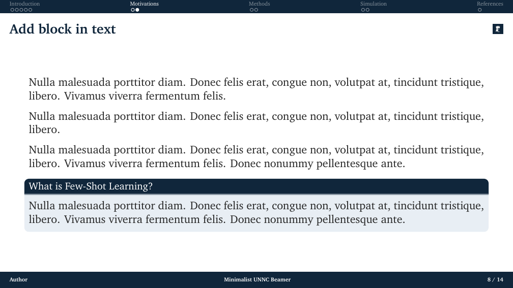
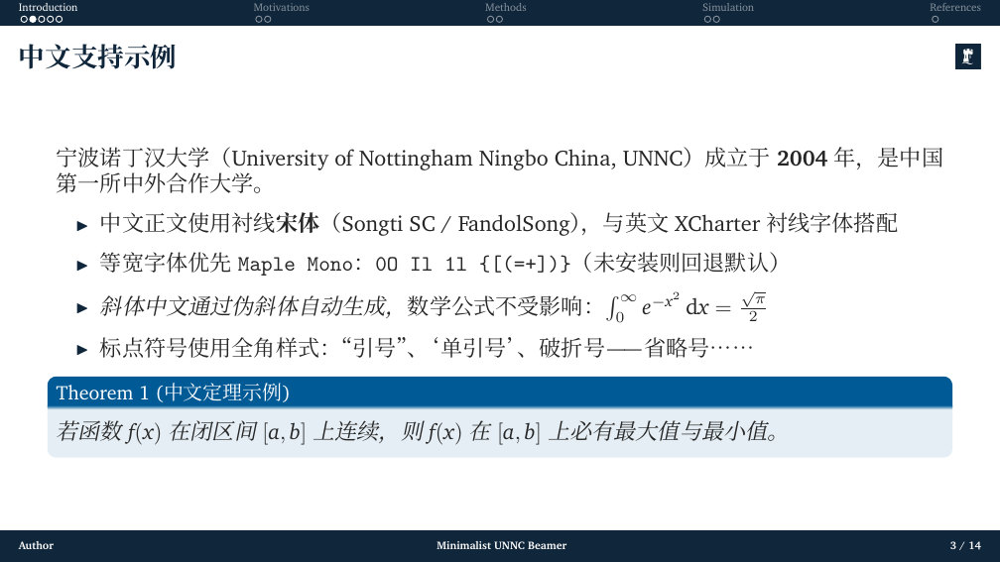

# Minimalist UNNC Beamer

极简 UNNC Beamer，位于 `minimalist/`。论文式模板在 [`thesis-style/`](../thesis-style/)（pdfLaTeX），总览见[仓库根目录 README](../README.md)。

宁波诺丁汉大学（UNNC）风格的极简 Beamer，支持中文。

A lightweight UNNC-style Beamer template with Chinese support.

## 预览

完整 14 页：[main.pdf](main.pdf)

封面（标题色块与 UNNC 字标）：



正文页（顶部为分节导航，当前节高亮）：



中文示例：



## 快速开始

编译器使用 **XeLaTeX**。pdfLaTeX 不能加载这里的中文字体。

**Overleaf**

1. **New Project** → **Upload Project**，只上传本目录（`minimalist/`）。仓库里还有一套论文式模板，两份 `main.tex` 需要分开编译。
2. Menu → Compiler 选择 **XeLaTeX**，主文件为 `main.tex`。
3. **重新编译两次**（第二遍刷新顶部导航、目录和文献引用。Overleaf 会在此过程中运行 BibTeX）。

**本地**

```bash
git clone https://github.com/shenhaoyuan0218/unnc-beamer-template.git
cd unnc-beamer-template/minimalist
latexmk -xelatex main.tex
```

`latexmk` 会按需运行 XeLaTeX 与 BibTeX。手动编译时同样编译两遍，并在中间跑一次 BibTeX：

```bash
xelatex main
bibtex main
xelatex main
xelatex main
```

## 改哪里

演示文稿里的作者是占位符 `Your Name / 作者姓名`，页脚短作者是 `Author`。换成自己的信息时，只改 `main.tex` 顶部：

```latex
\author[Author]{Your Name \; 作者姓名\\{\small\href{mailto:your.email@example.com}{\texttt{your.email@example.com}}}}
\title[短标题]{演示标题}
\subtitle{副标题}
\institute{University of Nottingham Ningbo China \\ 宁波诺丁汉大学}
\date{2026}
```

按 `\section{...}` 增删章节。每个非星号 section 会先插入一页目录，正文页顶部出现对应的分节标签。示例帧（中文、引用、公式、图文绕排、block、定理、表格）都可以直接替换。文献条目写在 `ref.bib`，正文用 `\citep` / `\citet`。

主题另外提供 `\studentid{}`、`\degree{}`、`\supervisor{}`、`\submitdate{}`，当前封面没有使用这些字段。

## 文件

| 路径 | 作用 |
| --- | --- |
| `main.tex` | 主文件：标题与作者占位、各节示例 |
| `beamerthemeUNNC.sty` | UNNC 主题：诺丁汉蓝、顶栏导航、帧标题校徽、页脚 |
| `figures/unnc_logo_full.pdf` | 封面字标矢量（官方 SVG 转 PDF）。同名 PNG 保留 |
| `figures/unnc_crest.pdf` | 城堡方标矢量，与 `unnc_crest.png` 同一图形。帧标题小图标仍用 PNG |
| `figures/unnc_logo_white.png` | 白色字标，随模板附带 |
| `ref.bib` | 示例文献，样式 `apalike` |
| `main.pdf` | 预编译全文 |
| `previews/` | 本页用的封面、顶栏正文和中文页截图 |

英文使用 XCharter。中文按顺序尝试 Songti SC、Noto Serif CJK SC、FandolSong（Overleaf 与 TeX Live 一般自带 FandolSong）。若本机装了 Maple Mono，等宽字体会用它，否则用默认字体。

## 改编说明

幻灯片结构改编自 [Minimalist PKU Beamer 2026](https://github.com/rexera/minimalist-pku-beamer-2026)（MIT）。标识、配色与 `beamerthemeUNNC.sty` 为宁波诺丁汉大学（UNNC）。
