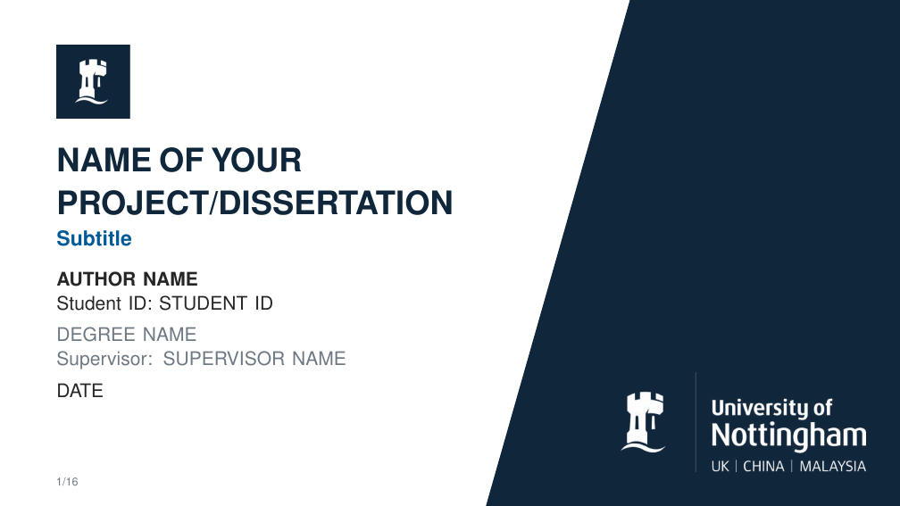
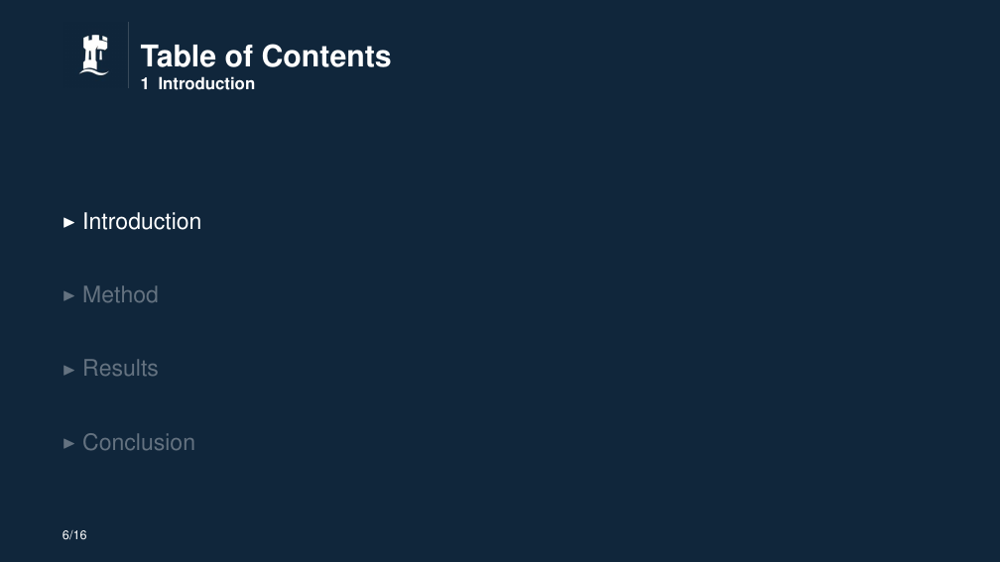
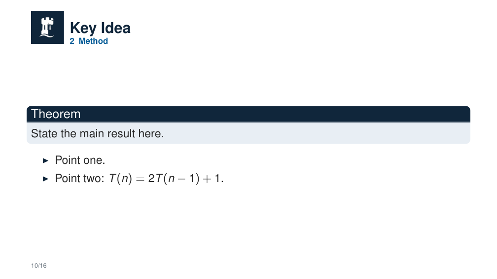

# Beamer 幻灯片模板

论文式 UNNC Beamer，位于 `thesis-style/`。另一套极简中文模板在 [`minimalist/`](../minimalist/)，总览见[仓库根目录 README](../README.md)。

本目录用 pdfLaTeX 编译，画面为 16:9。主题文件是 `beamerthemeUNNC.sty`，版式改编自 UNNC Overleaf 论文模板（Yue Li，2017 年 6 月；Denis Stepanov，2020 年 6 月）。

## 预览

完整 16 页：[main.pdf](main.pdf)

封面（第 1 页）：



节页（第 6 页，进入 Introduction 时的目录）：



正文（第 10 页，Method 中的 Key Idea）：



## 修改内容

在 `main.tex` 中填写 `\title`、`\subtitle`、`\author`、`\submitdate`、`\degree`、`\studentid`、`\supervisor`。

| 路径 | 内容 |
| --- | --- |
| `preface/` | 致谢、摘要、发表 |
| `body/00_body.tex` | 按顺序引入各章 |
| `body/` | 章节正文 |
| `appendices/appendix.tex` | 附录 |
| `bibliography/bibliography.bib` | 文献库，样式 `unsrt` |
| `figures/unnc_crest.png` | 页眉与封面校徽 |
| `figures/unnc_logo_white.png` | 封面白色标志 |
| `figures/unnc_logo_full.png` | 随模板附带，当前源文件未引用 |

## 编译

`main.tex` 注明使用 pdfLaTeX 与 BibTeX。在本目录执行：

```bash
pdflatex main
bibtex main
pdflatex main
pdflatex main
```

文献命令是 `\bibliography{bibliography/bibliography}`，BibTeX 需要在本目录运行。主题找到 `lato.sty` 时使用 Lato，否则使用 Helvetica（`helvet`）。随附的 [main.pdf](main.pdf) 由 pdfLaTeX 生成，正文为 Helvetica。`.gitignore` 忽略 aux、log、nav、snm、toc、out、vrb、bbl、blg 等编译中间文件。
